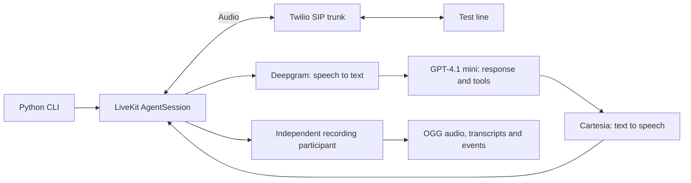

# Architecture

A local Python CLI creates a LiveKit room, connects an Agents `AgentSession`, starts a read-only recording participant, then creates a SIP participant to call the fixed test line through a stored outbound trunk. The patient uses a separate Deepgram Nova-3 speech recognizer, GPT-4.1 mini text model and Cartesia Sonic-3 speech synthesizer through LiveKit Inference. This keeps the required pipeline explicit and reduces account setup to LiveKit plus telephony. Short, scenario-specific instructions guide an adaptive conversation: the caller waits for the greeting, answers questions with consistent fictional details, uses a structured ending tool to save the factual outcome and speak a brief natural goodbye once resolved or blocked. It does not replay an interrupted ending. A closing state suppresses further generated questions while retaining clinic audio and transcription through a reply or an eight-second quiet grace period, bounded by the original deadline. The final budget window forces the ending tool; a pending task is labeled unresolved rather than completed. Silero VAD with an initial 1300 ms endpointing delay provides a simple local turn boundary. A 800 ms/three-word interruption threshold filters small noises; streaming stages and short utterances limit delay. Semantic end-of-turn detection is a possible improvement for hesitant speakers, but adds model/runtime complexity; this first version uses VAD and requires pilot listening to tune that tradeoff. Direct provider plugins would offer more control and independent billing, at the cost of more keys. These choices are hypotheses to validate on real calls, not measured latency or quality claims.

The independent recorder subscribes to the actual published patient and clinic audio before dialing and persists PCM tracks on a shared frame-arrival timeline and encodes stereo OGG in bounded blocks in an isolated process. This avoids an egress service and storage bucket, while requiring the local process to remain alive and introducing approximate timing under jitter. Both-sided transcripts, state changes and provider metrics are saved alongside the scenario and caller identity. A text evaluator proposes issues only from cited transcript turns; code verifies exact quotes and requires clinic evidence, while human audio review establishes whether a bug is real. Campaign locking, an explicit caller ID and a fixed destination keep runs sequential and consistent. A local call deadline, SIP duration cap, room deletion and fallback participant removal bound calls and clean up failures. An audit rejects missing or incomplete evidence and counts mechanically eligible calls; it cannot establish coherent dialogue, backend correctness or a completed submission.
